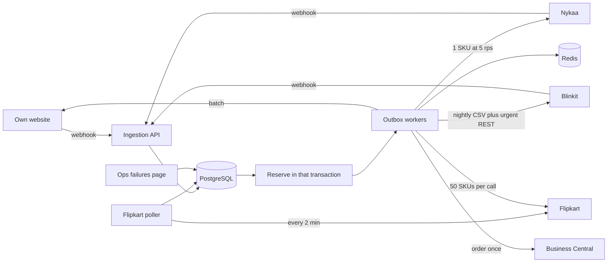

# Order & Inventory Sync Service

MARS sells about 1,200 SKUs from one warehouse on its own website, Nykaa, Flipkart, and Blinkit. A sale oversold about 900 units because each channel was updated by hand from a spreadsheet. This service reserves warehouse stock the moment an order is known, pushes that number to every listing, and sends each confirmed order to Microsoft Business Central once.

PostgreSQL holds the only stock counter. A listing is a copy. Two orders for the last unit hit one conditional `UPDATE`; one wins, the other is rejected. Marketplaces take payment before they tell us, so listings run behind real stock, and the last units are sold only on our website, where checkout can fail before an order exists.

One NestJS app, PostgreSQL, Redis, AWS Mumbai. Three developers, six weeks. Infra about ₹15,000–20,000/month, inside the ₹50,000 cap.

## Assumptions

1. Business Central stores our order id as an external document number and treats a repeat post as the same order.
2. Website, Nykaa, and Blinkit retry webhooks for 24 hours unless we return 2xx. Flipkart’s order API takes `updated_since`. All three marketplaces can cancel by external id.
3. The 1,200 SKUs already exist. An unknown SKU fails the whole order. Reservation is all-or-nothing across lines. Payment mode does not change it.
4. Webhooks use HMAC. Outbound APIs use a key or OAuth client in Secrets Manager.
5. Cancel of an unshipped order releases `reserved`. A return after shipment adds to `on_hand`. “Shipped” comes from polling Business Central every 10 minutes.
6. The 60-second listing target is for a normal day (~8,000 orders). The recent sales rate is a fair guess for the next two minutes. Ops can raise a per-SKU buffer before a sale.
7. The ops page is internal, behind the company VPN.

## 1. Architecture

At 300 orders/minute the system writes about 5 orders/second. One NestJS process is enough. Separate services would spend the six weeks on deploys rather than the stock lock.



| Piece | Where | Role |
| --- | --- | --- |
| NestJS, 2 tasks | ECS Fargate 0.5 vCPU / 1 GB, behind an ALB | Ingest, poller, workers, ops page |
| PostgreSQL Multi-AZ | RDS `db.t4g.small`, 50 GB, backups on | Orders, stock, ledger, inbox, outbox. Source of truth |
| Redis, one node | ElastiCache `cache.t4g.micro` | Shared rate limits and latest qty per SKU. Rebuilt from Postgres if lost |

Both tasks claim work with `FOR UPDATE SKIP LOCKED`. If Redis is down, ingest and reserve continue; listing updates pause until `channel_stock` is reloaded.

**Six weeks.** Weeks 1–2: schema, reserve, website and Nykaa, ledger. Weeks 3–4: Flipkart poll, stock push, ERP outbox. Week 5: Blinkit, ops page, alarms. Week 6: staging test at 300 orders/minute.

## 2. Data model

Sellable stock is `on_hand - reserved` on `inventory` (`sku` primary key, plus `buffer` and `version`).

| Table | Constraint that does the work |
| --- | --- |
| `orders` | Unique (`channel`, `external_order_id`). Status: `RESERVED → ERP_SENT → SHIPPED`, or `REJECTED_NO_STOCK`, `CANCELLED`, `RETURNED` |
| `order_items` | Primary key (`order_id`, `sku`) |
| `inbox` | Unique (`channel`, `external_order_id`, `event_type`). Raw webhook or poll row, written before any stock change |
| `stock_ledger` | Append-only: sku, deltas, balance after, reason, order id, time |
| `outbox` | Unique (`type`, `entity_id`, `channel`). Status, attempts, `next_attempt_at`, last error |
| `channel_stock` | Primary key (`sku`, `channel`): desired qty, last pushed qty, last pushed at |
| `channel_cursor` | Flipkart `updated_since` |

## 3. Order ingestion

`POST /webhooks/{channel}` checks the signature, inserts the body into `inbox`, commits, and returns 200. Work after that point can crash and still be retried from the row. The Flipkart poller runs every 2 minutes, requests orders since the cursor minus a 5-minute overlap, and writes the same inbox table. The overlap is safe because the unique key drops duplicates.

A worker maps each row to one shape: channel, external id, event (`ORDER_CREATED`, `CANCELLED`, `RETURNED`), time, lines, payment, pincode, total. Only the adapter is per channel.

It takes an advisory lock on (`channel`, `external_order_id`), so a create and a cancel for one order cannot run together. A cancel that arrives first is a tombstone: the later create is stored as `CANCELLED` and does not reserve. A second create for an order that already exists returns successfully and does not reserve again.

A down channel does not block the others. Flipkart errors leave the cursor in place and back off. Every 5 minutes we also read our website’s order tables, so a missed webhook is not stuck waiting on their retry.

## 4. Inventory consistency

```
lock(channel, externalId)
if already applied, or a cancel tombstone exists: record that and return
BEGIN
  insert order as RESERVED
  for sku in lines, sorted by sku:          -- same lock order, no deadlock
    UPDATE inventory SET reserved = reserved + qty, version = version + 1
     WHERE sku = ? AND on_hand - reserved >= qty
    if 0 rows: ROLLBACK; save REJECTED_NO_STOCK; enqueue cancel; return
  ledger + ERP outbox (key = order id) + set desired_qty
COMMIT
```

**Same second, two channels, one unit.** Both transactions run the `UPDATE`. Postgres locks the SKU row. The first sets `reserved = 1` and commits. The second matches zero rows, stores `REJECTED_NO_STOCK`, writes no ERP row, and cancels that marketplace order. On our website the same function runs inside checkout: the loser sees “out of stock” and no order is created.

Listings can still accept an order before our push lands. Section 5 keeps displayed qty behind real sellable so this race is rare. Leftovers count toward the 0.5% sale-day cancel budget. They are never reserved twice.

Cancel of `RESERVED` does `reserved -= qty`. Return of `SHIPPED` does `on_hand += qty`. The inbox unique key makes a second delivery a no-op.

## 5. Stock push

Workers push the latest desired qty once per dirty SKU, not once per order. Ten orders for one lipstick become one Nykaa call.

`unseen = max(1, sales of this SKU in the last 15 minutes × 2/15)`. That scales recent pace down to Flipkart’s two-minute poll, the longest we are blind.

- If sellable is above `unseen`, every channel shows `sellable - unseen`.
- If sellable is at or below `unseen`, Nykaa, Flipkart, and Blinkit show **0**. The website may still sell those units, because checkout reserves against the real counter and can refuse.

| Channel | Push | Limit | Normal day, 60-second target |
| --- | --- | --- | --- |
| Website | One batch to our API | None | Single write |
| Nykaa | One SKU per call | 5/s, so 300 SKUs/min | A normal minute dirties far fewer than 300 SKUs. Both tasks share a Redis token bucket |
| Flipkart | 50 SKUs per call | 10/s, stop on 429 | A few calls per minute |
| Blinkit | CSV of all SKUs at 02:00 IST. REST only when qty hits 0, drops by 5+, or sellable is under 10 | ~2% timeouts | Urgent rows use REST with retry. The file fixes overnight drift |

Queue order is: desired 0, then low sellable, then the rest. On a sale, more than 300 distinct SKUs can change in a minute, and Nykaa cannot refresh all of them in 60 seconds. Zeros go first, so the oversell case still moves. High stock can lag; its holdback covers that lag. The brief’s 60-second rule is normal load, which this clears.

## 6. Failure handling

A worker claims an outbox row with `SKIP LOCKED`. 2xx marks it `SENT`. Network errors and 5xx set it back to `PENDING` with exponential backoff, cap 5 minutes, plus jitter. One order cannot block another.

**Sunday ERP downtime.** Rows retry until Business Central accepts them. They are not dead-lettered on a clock. Ingest does not wait on ERP, so other channels keep selling. A two-hour peak is about 36,000 rows Postgres already holds. The alarm watches the oldest pending row.

**Blinkit.** Timeouts use that same backoff. Local stock is already reserved; a failed push only leaves the listing stale, so zeros stay at the front of the queue. If over 5% of Blinkit calls fail for 15 minutes, non-urgent REST pauses. The nightly file and the zero-stock calls continue.

**Poison messages.** A 4xx that will not succeed on retry (unknown item, rejected body) becomes `FAILED` immediately. The ops page shows target, order or SKU, last error, attempts, and age, with Retry. Retry sets `PENDING`. Correcting a bad payload is a data fix, then Retry.

That outbox row is written in the reserve transaction, so a crash, a Redis outage, or the Sunday window cannot drop it. The worker sends it later with the same key.

## 7. Observability

CloudWatch alarms from day one:

1. **No-stock rejects** ÷ orders, 1-hour window, per channel. Page at 0.3%, under the 0.5% sale limit.
2. **Stock-push lag p95** per channel (`pushed_at − inventory.updated_at`). Page above 60 seconds for 10 minutes.
3. **Oldest ERP outbox age.** Page at 30 minutes Monday–Saturday, and at 3 hours on Sunday.
4. **Inbox age p95.** Page at 2 minutes. The webhook is stored but not reserved yet.
5. **429s and timeouts** per channel. Page when Blinkit errors exceed 5% for 15 minutes.

For any SKU, `stock_ledger` ordered by time is the audit: reason, delta, order, channel, balance after.

## 8. Out of v1

Not in the six-week build: a second warehouse, automatic buffers, price or image sync, partial-line cancels, returns inspection, customer email, payment calls, Kafka, extra services, and a chat bot over the ledger. The ledger is the “why did stock change” answer.

## Trade-offs

| Decision | Chosen | Rejected, and why |
| --- | --- | --- |
| Stock authority | One Postgres counter. Listings lag. At low stock, marketplaces show 0 and the website sells the rest synchronously | Fixed per-channel quotas strand units on a quiet channel. Showing full sellable qty on four listings is the 900-unit failure |
| ERP delivery | Outbox insert in the reserve transaction. HTTP retries plus their idempotency key | A queue publish after commit loses the order if we crash in between. Calling ERP inside the webhook ties every sale to Sunday downtime. Kafka is unnecessary at 5 orders/second |
| Listing updates | Latest qty only, zeros first. Blinkit: nightly file, REST for urgent drops | One call per order line exceeds Nykaa’s 300 SKUs/minute on a sale and publishes numbers that are already wrong. Blinkit’s timeout rate makes it a bad path for every small change |

## AI usage

Cursor (Composer) drafted this note and the diagram from the brief. The author must walk through the reserve `UPDATE`, the holdback rule, and the outbox on the follow-up call.
